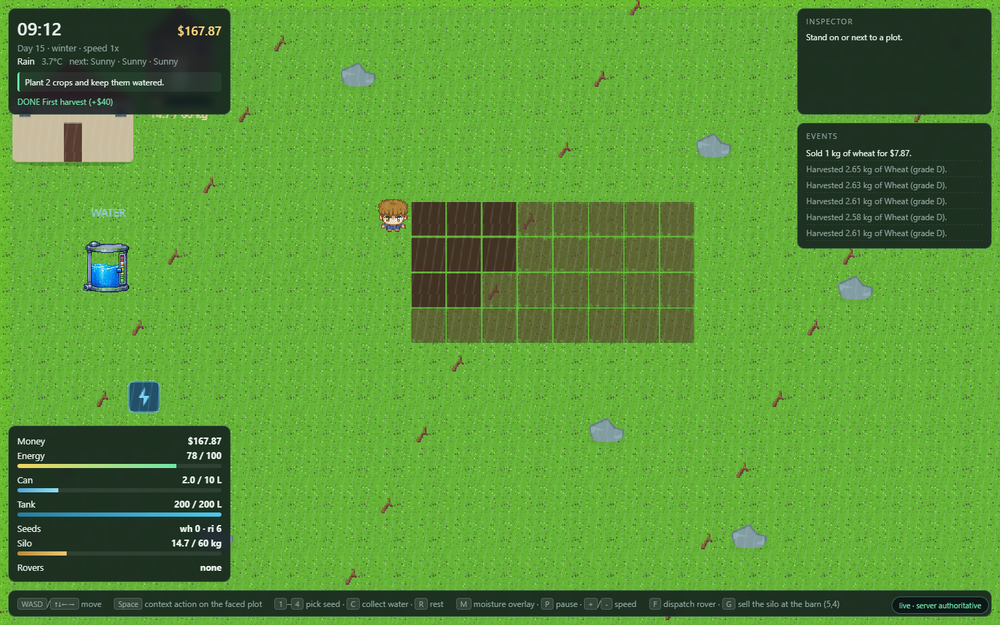

# farm-sim — a server-authoritative farm simulation

A rewrite of the original Phaser farm prototype (`../my_phaser_game`) as a
**dynamic, deterministic simulation that runs on the server**, with the Phaser
game reduced to a pure renderer and a uniform action API for LLM agents.

The original prototype kept every rule in the browser (`FarmScene.js`): growth
timers, water, inventory and the goal all lived in Phaser objects, the server
only stored whatever the Python agent posted, and the renderer leaked one stone
sprite per poll. That made the game unplannable (the world changed while the
agent was not looking), unmeasurable and impossible to test. Here the server
owns the truth:

```
              POST /api/v1/action                 SSE /api/v1/stream
 LLM agent ────────────────────────┐      ┌──────────────────────────► Phaser renderer
 (or a human with the keyboard)    ▼      ▲
                              ┌─────────────────┐
                              │   Simulation    │  fixed 500 ms tick
                              │  sim/ (pure JS) │  time · weather · soil · crops
                              └─────────────────┘  water · economy · robots · objectives
                                       ▲
                                       │ node --test / runner.js
```

## Quick start

```bash
cd farm_sim
npm install          # express only
npm start            # http://127.0.0.1:3100
```

Open <http://127.0.0.1:3100> for the game. Useful environment variables:

| variable | default | meaning |
| --- | --- | --- |
| `PORT` | `3100` | HTTP port |
| `HOST` | `127.0.0.1` | bind address |
| `PRESET` | `normal` | `easy`, `normal` or `hard` |
| `SEED` | `1` | RNG seed for the first episode |
| `LOG_REQUESTS` | `1` | print every state-changing API call (`0` silences it) |

Every `POST /api/v1/*` is echoed in the server terminal, e.g.
`[farm-sim] POST water [12,8] -> ok Watered plot p01 with 2 L. (3 ms)`, so an
agent run can be followed without a browser. The 500 ms ticker never logs.

> **Port used by the Python baseline.** `project_code/agentic_approach_baseline_farm_sim.py`
> targets `http://127.0.0.1:3111` (`server_urls.farm_sim_url` in
> `project_code/config.yaml`). Start the sim with `PORT=3111 npm start`
> (PowerShell: `$env:PORT=3111; npm start`) and open <http://127.0.0.1:3111>,
> otherwise the agent posts to a port this server is not listening on. `--url`
> overrides it per run. The client itself - flags, modules, artefacts - is
> documented in [`../project_code/README.md`](../project_code/README.md).

Other commands:

```bash
npm test                                               # 100+ tests (node --test)
node runner.js --preset easy --days 8 --policy care     # headless metrics table
node runner.js --preset hard --days 10 --policy idle --csv out/idle.csv
```

## Controls

`WASD` / arrows move one tile · `Space` context action on the faced plot
(harvest → clear → weed → treat → water → till → plant) · `1`–`4` pick a seed ·
`C` fill the can · `R` rest · `M` moisture numbers · `P` pause · `+`/`-` speed ·
`F` dispatch a rover · `G` sell the silo (stand within 2 tiles of the barn at
`(5,4)`). Mouse wheel zooms.

Your balance is shown twice: as the gold chip next to the clock (it flashes
`+$`/`-$` when it changes) and as the `Money` row in the bottom-left stats card.
Harvesting only fills the silo — money arrives when you **sell**.

## Repo layout

```
farm_sim/
├── server.js              Express: static client, /api/v1/*, legacy protocol, SSE, ticker
├── runner.js              headless episodes + metrics (shared with the golden tests)
├── sim/
│   ├── config.js          every tunable: world size, presets, weather tables, reasons
│   ├── rng.js             seeded mulberry32 + FNV-1a digest
│   ├── world.js           world factory, plot index, tile helpers
│   ├── loop.js            the tick pipeline + advance(n)
│   ├── actions.js         the action registry (validation + reasons)
│   ├── observation.js     the JSON state the renderer/agents read
│   ├── legacy.js          25 px compatibility adapter for the old agents
│   ├── metrics.js         score / shaped reward
│   ├── nav.js             4-direction A*
│   ├── tools.js           tool schema for LLM function calling
│   ├── data/crops.json    wheat, rice, corn, tomato
│   └── systems/           time, weather, soil, crop, water, economy, robots, objective, events
├── public/                Phaser renderer (no rules) + DOM HUD
├── docs/screenshot.png    what it looks like
└── test/                  node --test suites incl. golden scenarios
```

## Simulation model

One tick is **12 simulated minutes**; 120 ticks is one day; the world ticks every
**500 ms** of wall-clock time (a day takes one minute unless you change the
speed or call `/api/v1/advance`). Night is 20:00–06:00 and slows growth.

**World** — 32×24 tiles of 32 px (1024×768 px), 32 plots in an 8×4 field at
`x 12..19, y 8..11`. Landmarks: farmhouse `(2,6)`, silo `(5,4)`, water tank
`(3,10)`, rover charger `(4,13)`, player start `(8,4)`, six rocks.

**Weather** — `sunny`, `cloudy`, `rain`, `storm`, `heatwave`, `frost`, drawn per
day from a per-season Markov chain (`hard` uses a harsher table, `easy` uses a
fixed script so episodes are fully reproducible). Weather drives temperature
(season baseline + diurnal curve), humidity, wind and `rain_rate`. A naive
forecast is published for the next three days and never consumes RNG.

**Soil** — per plot `moisture` (0..1), `fertility`, `ph`, `temp_c`.
Evapotranspiration removes moisture every tick; it is larger when it is hot,
windy, sunny and when the surface is wet, but the temperature multiplier is
capped at 1.6x so that one heatwave cannot demand more water than the rovers and
a farmer's can can physically deliver. Rain adds moisture, irrigation adds `0.09`
moisture per litre, water above 92% runs off. A plot at 100% moisture dries out in
roughly three sunny days, so crops want water about every other day.

**Crops** — growth per tick is `factor / (days * 120)`, where `factor` combines
water (0.15 at bone dry → 1 in the optimal band), temperature, season, light
(night 0.6), weeds, disease and health. Health falls under stress (drought, frost,
heat, waterlogging) at 0.002/tick at full stress - about four days of total
neglect - and a crop dies below 0.05, so neglect costs yield before it costs the
plant. Weeds and blight appear on new days (`normal`/`hard` only) and blight
spreads to neighbours. A ripe crop left standing loses quality. Harvest yields
`base_kg * care * health * weeds` plus a letter grade.

**Water** — one shared tank (`capacity`, pump refill per tick, rain harvesting).
The watering can holds `can_capacity` litres (20 / 20 / 12); every watering spends
`water_per_action` (4 L, i.e. `0.36` moisture - one crop band) and moves exactly
those litres from the can into the soil. Rovers carry their own 24 L tank but
refill from the same tank, so water is strictly conserved (see `test/water.test.js`).

**Economy** — shared silo (60 kg, spoilage on higher presets), prices that
random-walk daily and follow seasonal multipliers, and delivery contracts with
a premium. Trading happens at the silo.

Money leaves `player.money` the moment you spend it (seed `$4`–`$7` each,
treatment `$4`, fertiliser `$6`); a harvest only adds kg to the silo, so the
balance moves when you **sell** — `sell` over the API, or `G` within two tiles of
the barn.
The HUD shows the balance next to the clock (it flashes the delta), the stats
card has a silo fill bar that turns amber/red as the silo fills, and the barn
carries a matching kg meter in the world.

**Robots** — rovers pick the driest planted plot, path to it with A*, irrigate,
refill, recharge when the battery is low and keep patrolling until recalled. A
rover that had to break off for a charge resumes watering on its own instead of
going idle (an idling rover silently stopped irrigating for the rest of the
episode unless the agent spent another step re-dispatching it).

**Energy** — 1 per tile walked plus action costs. A short break restores 25
anywhere, the farmhouse restores you fully. (Without the anywhere-rest an agent
could deadlock at 0 energy - a bug the golden tests now guard against.) An action
that cannot move at all fails loudly: `move` reports `NO_ENERGY`, and since
`move_to` throws the same reason when it cannot take a single step it no longer
answers `ok: true` with `steps: 0`.

**Objectives** — a deadline and a cash reward, one per preset by default: plant
and water two crops (`easy`), harvest three before day 10 (`normal`), earn $150 and
harvest four before day 18 (`hard`). The objective is what the Python baseline
hands the model as its task
(`project_code/agentic_approach_baseline_farm_sim.py` reads `objective.text` from
the state; `--task "..."` only rewrites that wording), so the prompt and the
score agree. The server re-evaluates the objective inside every action as well as
in the tick, so the action that completes it already answers with
`objective.is_complete: true` (and the shaped `reward` of that action carries the
objective bonus) instead of reporting the win one tick late.

The preset and the objective are separable: `POST /api/v1/reset` takes
`{preset, objective}`, and the Python baseline exposes that as
`--objective <id>` (`--list-objectives` prints the catalogue). So
`--preset easy --objective harvest_normal` is the *easy* world - $120, 12 seeds,
a 200 L tank at 60 %, scripted weather, no pests, weeds, rovers or spoilage -
scored on "Harvest 3 crops before the end of day 10" (+$60). Any preset accepts
any id (`GET /api/v1/objectives` lists them), so a run can hold the goal fixed
while the preset varies the difficulty (or the reverse). An unknown id falls back
to `starter_easy` server-side, which is why the CLI validates it first.

The baseline pins the rest of the run contract so that a log can be trusted: the
`.log` is rewritten per run instead of appended (a `filemode='a'` bug mixed up to
20 episodes into one file), the episode's objective is verified against
`--objective` (a mismatch aborts with exit code 3), `--max-advance-ticks` (default
120 = one game day, `0` = off) and the objective deadline cap every `advance` call
and a clipped call says so in `note`, a zero-step `move_to` is recorded as
`NO_PROGRESS` with the fix in the message, and the summary carries `stop_reason`
(`objective_complete`, `objective_failed`, `max_steps`, `silent_steps`,
`llm_error`, `check_api_pass`/`check_api_fail`). The cap is also stated where the
model reads it - the `advance` tool description and a closing `budget:` line in
every observation (steps left, in-game days to the deadline, per-call cap) - because
a clipped jump nobody sees is a step spent on a wrong assumption: the recorded
`normal` and `hard` runs chained `advance` calls asking for 3-4 days, never watered
in between, and lost all three crops to `drought_stress`.

## Action API

Every action goes through `POST /api/v1/action` with a uniform envelope:

```jsonc
// request
{ "type": "water", "tile": [12, 8] }

// response
{
  "ok": true,
  "action": "water",
  "reason": null,
  "message": "Watered plot p01 with 2 L.",
  "data": { "plot": "p01", "litres": 2, "moisture": 0.48, "can_litres": 8 },
  "reward": 0
}
```

Failures use the same shape with `ok: false` and a machine-readable `reason`:
`UNKNOWN_ACTION`, `BAD_ARGS`, `PAUSED`, `TOO_FAR`, `OUT_OF_BOUNDS`,
`BLOCKED`, `NO_PLOT`, `NOT_TILLED`, `ALREADY_TILLED`, `OCCUPIED`, `NO_CROP`,
`CROP_DEAD`, `NOT_READY`, `NO_SEEDS`, `NO_MONEY`, `TANK_EMPTY`, `CAN_EMPTY`,
`NOT_AT_TANK`, `NO_ENERGY`, `NO_PATH`, `NOTHING_TO_DO`, `SILO_FULL`,
`NO_ROBOT`, `ROBOT_BUSY`. `TOO_FAR` means "walk closer"; `OUT_OF_BOUNDS` is the
map edge only.

| action | arguments | notes |
| --- | --- | --- |
| `move` | `dir` or one of `dx`/`dy` | one tile per call; rocks and bounds block |
| `move_to` | `tile`, `steps?` | A* walk, 1 energy per tile; `NO_ENERGY` when it cannot take one step |
| `till` | `tile?` | empty plot only, 4 energy |
| `plant_crop` | `crop`, `tile?` | tilled + seeded plot, within 1 tile |
| `water` | `tile?` | 2 L from the can, 2 energy |
| `collect_water` | `liters?` | stand next to the tank `(3,10)` |
| `harvest` | `tile?` | ripe crop only, stores into the silo |
| `clear` | `tile?` | remove a dead/unwanted crop |
| `weed` / `treat` / `fertilize` | `tile?` | weeds, blight ($4), fertility ($6) |
| `scan` / `inspect` | `radius?` / `tile` | read-only, no energy |
| `buy` / `sell` | `crop`, `qty?` / `kg?`, `contract?` | within 2 tiles of the silo |
| `dispatch` | `task`, `robot?` | `water`, `charge`, `recall` |
| `rest` | – | +25 energy anywhere, full at the farmhouse |
| `advance` | `minutes?`/`ticks?` | fast-forward, 1 tick = 12 min, at most 5000 ticks per call (the Python baseline caps it at a day and at the objective deadline) |

`tile` always accepts `[x, y]`, `{x, y}` or a `plot_id` (`"p07"`); when omitted
the action applies to the plot you stand on, otherwise to the tile you face.

`POST /api/v1/actions` takes `{actions: [...]}` (or a bare array, max 50) and
applies the list in order, which is how an agent can spend a whole turn in one
round trip instead of one request per action. The reply carries one result per
entry, in the same order:

* `{include_state: true}` → `state` with the observation after the last action
  (cheap: one observation for the whole turn).
* `{include_states: true}` → `results[i].state` with the observation after that
  action, exactly what the i-th single `POST /api/v1/action` would have returned.
  Use it when the caller has to follow the farmer's path tile by tile; combine it
  with `include_state` to also get the closing observation with its event list.

Both flags are also accepted as query parameters (`?include_state=1`). The Python
harness drives the single-action route (`POST /api/v1/action`) and does not use
this endpoint; it stays for replaying recorded trajectories and for other clients.

### State

`GET /api/v1/state` returns everything the renderer needs and nothing it does
not: `tick`, `seed`, `preset`, `time` (day, clock, season, paused, speed),
`weather` (type, temperature, humidity, forecast), `world` (tile size, pixel
size), `player` (tile, pixel position, facing, energy, money, can, seeds),
`tank`, `plots[]` (tile, tilled, moisture, band, needs_water, crop with growth /
stage / health / weeds / disease / days_to_ripe), `obstacles`, `landmarks`,
`robots[]`, `market` (prices, contracts), `silo`, `objective` (progress,
deadline, state), `metrics`, the last events and the crop catalog.

`GET /api/v1/schema` and `/api/v1/tools` return the tool definitions in
`sim/tools.js` — feed them straight into an OpenAI/Ollama tool-calling request.

### HTTP endpoints

| method | path | purpose |
| --- | --- | --- |
| GET | `/api/v1/health` | liveness, tick, episode, connected clients |
| GET | `/api/v1/config` | presets, actions, reasons, crops, objectives, world constants |
| GET | `/api/v1/objectives` | objective catalogue: `id`, `label`, `text`, `deadline_day`, `reward` |
| GET | `/api/v1/state` | full observation (`?events=0` to trim) |
| POST | `/api/v1/action` | one action (`include_state: true` echoes the state) |
| POST | `/api/v1/actions` | batch of actions (`include_state`, `include_states`) |
| POST | `/api/v1/advance` | `{minutes}` or `{ticks}` fast-forward |
| POST | `/api/v1/reset` | `{seed, preset, task, objective, speed}` new episode |
| POST | `/api/v1/pause` | `{paused}` |
| POST | `/api/v1/speed` | `{speed}` 1..20 |
| POST | `/api/v1/task` | set the task text shown in the HUD |
| GET | `/api/v1/stream` | server-sent events, one `state` frame per tick |
| GET | `/api/v1/legacy` | the legacy 25 px view |
| GET | `/api/v1/schema`, `/tools` | LLM tool definitions |
| GET/POST | `/get_game_state`, `/post_game_state` | original protocol (below) |
| POST/GET | `/set_game_task`, `/get_game_task` | task text for the old agents |

## Scoring: the points an agent earns

The simulation is the only judge - there is no reward model and no external
evaluator. It keeps a handful of counters while the episode runs, turns them into
one scalar (`sim/metrics.js`) and reports that scalar plus the objective bonus.
An agent cannot earn points by talking or by looking at the field: only selling,
harvesting, watering/keeping crops alive and finishing the objective move the
number.

### Where the points show up

| surface | field |
| --- | --- |
| every `POST /api/v1/action` reply | `reward`: the points this single action changed (can be negative) |
| `GET /api/v1/state` (and the state echoed by `/action`) | `metrics.score`, `metrics.reward`, `objective.progress` / `reward` / `is_complete` / `is_failed` |
| the episode is won | `objective.reward` is paid into `player.money` |
| `runner.js` | the `score` column and the closing `score=` line |
| the Python client | `points_gained` in `_summary.json` (= `metrics.score`) |

### The score

`sim/metrics.js` is the whole definition:

```
score = earned              # $ from selling, at the market price of the day
      + 8  * harvests       # every harvested crop, independent of weight
      + 0.5 * kg_harvested  # weight, so a big harvest beats a small one
      + 50 * objective_completed   # the goal is worth more than any single action
      - 0.25 * invalid_actions     # a rejected action
      - 2  * crops_died            # a crop that withered
```

rounded to two decimals. Each term is a counter in `world.metrics`
(`sim/world.js`):

| counter | incremented by | weight | why |
| --- | --- | --- | --- |
| `earned` | `economy.sell` (`economy.js`) | 1 | the farmer's actual revenue, so market timing counts |
| `harvests` | `crop.harvest` (`crop.js`) | 8 | progress on the objective, cheap to reach |
| `kg_harvested` | `crop.harvest` | 0.5 | rewards yield, not only count |
| `objective_completed` | `objective.update` (`objective.js`) | 50 | the goal dominates everything else |
| `invalid_actions` | `applyAction` (`actions.js`) | -0.25 | a rejected call costs something but not the run |
| `crops_died` | `crop.update` (`crop.js`) | -2 | neglect is punished, still cheaper than a lost harvest |

The other counters (`actions`, `valid_actions`, `kg_sold`, `kg_spoiled`, `spent`,
`water_used`, `water_collected`, `robot_tiles`, `tiles_walked`, `reward`) are
reported in the state and in the summaries but carry **no** score weight -
spending money or watering is not scored by itself, only through the harvest and
the objective it enables.

### The reward on a single action

`applyAction` (`sim/actions.js`) computes

```
scoreBefore = computeScore(world)
... the action ...
objective.update(world)          # may complete the goal and pay the bonus
result.reward = computeScore(world) - scoreBefore
```

and adds it to `world.metrics.reward`. Consequences worth knowing when reading a
log:

* the action that completes the objective carries the whole **+50** itself, plus
  whatever it earned otherwise;
* a rejected action is exactly **-0.25** (only `invalid_actions` moved);
* `advance` can be **negative**: crops die, spoil or the season turns while the
  clock runs;
* a valid but pointless action (`scan`, `inspect`, `record`, a successful
  `advance` over a healthy field) is **0**, and so is `water` on already-moist
  soil - the agent pays for those in steps, not in points.

### The three objectives

The goal is data plus a predicate (`sim/systems/objective.js`), and it is scored
twice: 50 points through `objective_completed`, and its `reward` in money.

| id | text | deadline | reward | `complete()` |
| --- | --- | --- | --- | --- |
| `starter_easy` | Plant 2 crops and keep them watered. | day 8 | $40 | `planted >= 2 && watered >= 2` |
| `harvest_normal` | Harvest 3 crops before the end of day 10. | day 10 | $60 | `harvests >= 3` |
| `profit_hard` | Earn $150 from sales and harvest 4 crops before day 18. | day 18 | $100 | `earned >= 150 && harvests >= 4` |

"Watered" means irrigated **after** planting and still moist - rain alone never
counts. Completion pays `reward` into `player.money` (not into `earned`, so the
money bonus is *not* scored a second time), sets `objective_completed = 1` and
stamps `completed_day`. Missing the deadline sets `is_failed` and ends the
episode: no fine is subtracted, but the 50 points and the money bonus are gone
and the agent stops there.

### A worked example

`node runner.js --preset normal --seed 2 --days 9 --policy care --plots 4` - after
the first real harvest day the counters read `earned=69.33`, `harvests=3`,
`kg_harvested=7.65`, `objective_completed=1`, `invalid_actions=0`,
`crops_died=0`:

```
69.33 + 8*3 + 0.5*7.65 + 50*1 = 147.16
```

with `player.money = 60 (start) + 69.33 (sales) + 60 (objective reward) = 189.33`.
The objective bonus never shows up in `earned`, which is why the score cannot be
reconstructed from the wallet alone.

### What does not score

* the wallet, the silo and the tank - only their *effects* (a sale, a harvest)
  are counted;
* `scan`, `inspect`, `record`, and a successful `advance` over a healthy field:
  valid, 0 points, but they consume steps;
* buying: seeds and water cost money (`spent`) but are not penalised, and selling
  on a bad market day simply earns less;
* being slow without failing: a run that hits the step limit scores what it
  accumulated, nothing is subtracted.

### Live versus cached score

`metrics.score` in the state is computed on read (`sim/observation.js`), so it is
always current. The runner's daily `score` column prints `world.metrics.score`,
which `sim/loop.js` refreshes once per tick, so after actions that happen between
two ticks the column can lag the live value by one tick (the closing `score=`
line is the value at the last tick). Query `GET /api/v1/state` when an exact
figure matters.

## Legacy compatibility (`agentic_approach*.py`)

The original agents move in **25 px** steps (`a_star_algo.py` hardcodes
`TILE_SIZE = 25`) and post their whole world back. The adapter maps those cells
onto the new 32 px tiles one-to-one and exposes pixels as `tile * 25`:

| legacy | new |
| --- | --- |
| `grid_size [800, 600]` | 32×24 tiles of 25 legacy-px |
| `player_pos [200, 100]` | tile `(8, 4)` |
| `water_tank [75, 250]` | tile `(3, 10)` |
| obstacle `[250, 100]` | rock at `(10, 4)` |
| crop at `[300, 200]` | plot `p01` `(12, 8)` |
| crop at `[400, 275]` | plot `p29` `(16, 11)` |

`POST /post_game_state` replays only the transitions the old protocol can
express: `player_pos` moves the farmer (rocks/bounds reject), `planted: true`
plants (and tills, because the old agents never till), `needs_water: false`
waters, `planted: false` clears, and `water_available: true` fills the can from
the tank. `goal_completed` is computed by the simulation and only echoed back.

So `state["crops"]` now contains **32** entries (`crop1`..`crop32`) instead of
three. Agents that iterate their own local dict are unaffected; anything that
assumes exactly N crops should switch to `/api/v1/state`.

A `config.yaml` that still points at `http://localhost:3000` (older agent
variants) needs the new server started with `PORT=3000 npm start`; the current
`project_code/config.yaml` uses `127.0.0.1:3111` instead.
`sim/legacy.js` ignores the tuple-keyed crop entries the old agent posts
(`"(400, 275)"`); only entries with a `pos` array are replayed.

## Headless runner

```
$ node runner.js --preset normal --seed 2 --days 9 --policy care --plots 4
farm-sim runner · preset=normal seed=2 days=9 policy=care plots=4
day  season  weather   temp planted ready dead moist tank  money  harv kg    earned score objective
1    spring  sunny     20   0       0     0    0     56    60     0    0     0      0     open
6    summer  sunny     31   4       0     0    0.889 160   189.33 3    7.65  69.33  147.16 done
10   autumn  cloudy    14   3       0     0    0.746 160   205.8  4    10.25 85.8   147.16 done

actions=88 valid=88 invalid=0 water_used=80L harvests=4 (10.25 kg) earned=$85.8 score=147.16
```

The objective is done on day 6 (`3 harvests`), the bonus is paid into `money` and
the fourth harvest on day 10 only adds `earned`/`harvests` - the `score` column
lags one tick there, because `metrics.score` is refreshed by the tick loop rather
than by the action (see [Scoring](#scoring-the-points-an-agent-earns); the live
value after day 10 is `85.8 + 8*4 + 0.5*10.25 + 50 = 172.93`). `--policy care`
runs a simple farmer (fill can → water dry plots → harvest → sell), `--policy
idle` does nothing. `--csv out.csv` writes the daily table. The runner is also
what the golden tests reuse, so the numbers in a paper and the numbers in the
tests come from the same policy.

## Tests



```bash
npm test        # node --test test/
```

| suite | pins down |
| --- | --- |
| `rng.test.js` | seed reproducibility, bounds, weights, hashing |
| `soil.test.js` | drying, rain, clamping, litres → moisture |
| `crop.test.js` | ripening time, drought death, health recovery, yield/grade, weeds, over-ripening, disease |
| `actions.test.js` | every success path and every `reason` code, incl. `move_to` without energy (`NO_ENERGY`, 0 steps) and an objective completed by the winning action |
| `water.test.js` | tank ↔ can ↔ soil conservation, capacity, pump, rain |
| `determinism.test.js` | same seed + same actions ⇒ same digest; `advance(n)` == n ticks; fog; pause |
| `golden.test.js` | care vs neglect vs drought, rover autonomy, objective win/lose |
| `legacy.test.js` | 25 px view, one-shot plant+water, rejections, no water from nothing |
| `api.test.js` | boots the real server: client assets, reset, action envelope, advance, legacy routes, pause, 404, SSE |

`stateDigest(world)` (FNV-1a over tick, plots, crops, water, money, objective)
is the regression handle: any balance change that alters an episode shows up as
a digest change in `determinism`/`golden`.

## Design notes and limits

* **Movement is discrete and instant.** One `move` = one tile, one energy. The
  clock keeps running, so a slow agent is penalised by the world, not by
  animation time. This keeps planning honest and tests fast.
* **The walk animation is client-side only.** The server reports the resulting
  tile(s) and the renderer glides to `player.pos` with a distance-proportional
  tween (~60 ms per tile, clamped to 150–600 ms), so a one-tile `move` looks like
  a step while a 14-tile `move_to` glides instead of teleporting. The sprite's
  facing is derived from the tile delta for the same reason (`move_to` does not
  set `facing`). No frame ever carries the intermediate tiles of a path.
* **One world per server process.** `POST /api/v1/reset` replaces the episode;
  opening two browser tabs shows the same farm (it is a single-player world).
* **No persistence yet.** Nothing is written to disk; an episode lives in
  memory. `reset` is the only way to start over.
* **Rovers ignore plots** when pathing and never trample crops.
* **Fog of war** exists only on `hard`: plots further than 10 tiles are reported
  as `{known: false}` (the renderer darkens them). 6 of 32 plots are visible at
  spawn, so the agent has to explore.
* **No auth / no rate limiting** — it is a localhost research tool.
* **The economy is a toy model**: daily random walk + seasonal multipliers +
  flat contracts, enough to make selling decisions non-trivial.

## Troubleshooting

* *Port already in use* — `PORT=3200 npm start`.
* *Blank canvas* — Phaser is loaded from jsDelivr; if the machine is offline,
  copy `phaser.js` next to `public/` and change the `<script>` tag in
  `public/index.html`.
* *“reconnecting…”* — the SSE stream was blocked (proxy). The client falls back
  to polling `/api/v1/state` every second automatically.
* *Screenshots / automated UI checks* — append `?nolive=1` (no stream, no
  polling) and read `document.body.dataset.scene` / `.plots` / `.clientError`.
